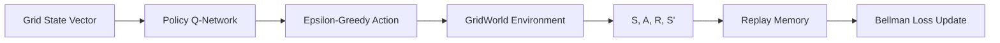

# Deep Reinforcement Learning: Autonomous Grid Navigator


A modular deep reinforcement learning framework demonstrating value-based policy learning with experience replay, target networks, and spatial trajectory visualization.

## Architecture


## Run Simulation
```bash
python src/cli/play.py
```
